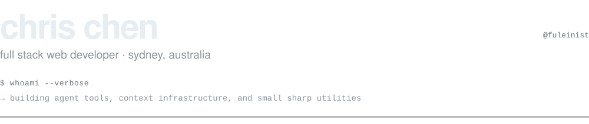
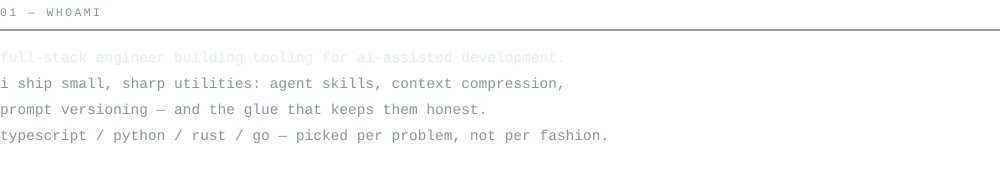
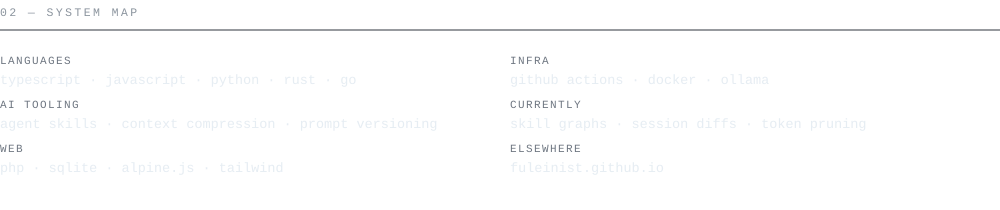
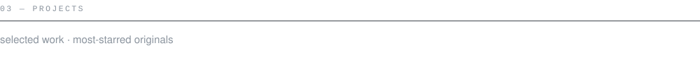
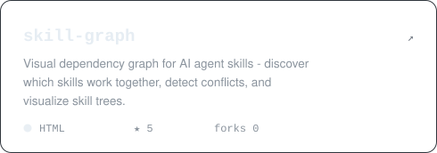
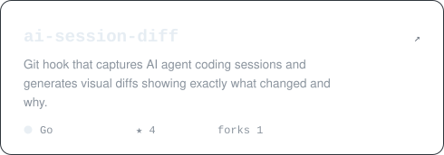
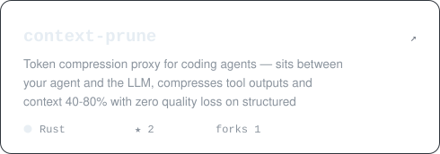
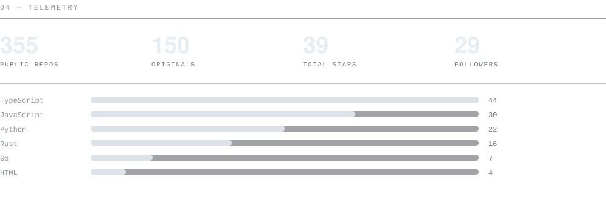
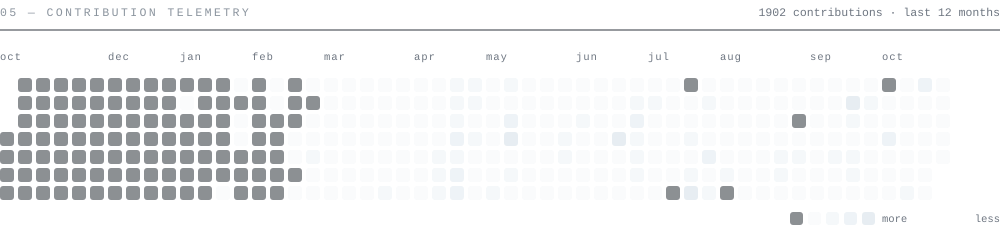
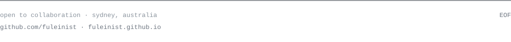

<!-- profile readme · github.com/fuleinist
     every panel is a local svg in /assets (light + dark) so nothing
     renders broken. telemetry + contribution svgs and the star counts
     inside the project cards are regenerated from live github data by
     .github/workflows/telemetry.yml — never edit those by hand. -->

<picture>
  <source media="(prefers-color-scheme: dark)" srcset="assets/header-dark.svg">
  <source media="(prefers-color-scheme: light)" srcset="assets/header-light.svg">
  
</picture>

  
  

<picture>
  <source media="(prefers-color-scheme: dark)" srcset="assets/whoami-dark.svg">
  <source media="(prefers-color-scheme: light)" srcset="assets/whoami-light.svg">
  
</picture>

<picture>
  <source media="(prefers-color-scheme: dark)" srcset="assets/ecosystem-dark.svg">
  <source media="(prefers-color-scheme: light)" srcset="assets/ecosystem-light.svg">
  
</picture>

<picture>
  <source media="(prefers-color-scheme: dark)" srcset="assets/projects-dark.svg">
  <source media="(prefers-color-scheme: light)" srcset="assets/projects-light.svg">
  
</picture>

<!-- project cards: one per featured repo, 2-up, each links to its repo;
     star counts inside are refreshed by the telemetry workflow -->

  <a href="https://github.com/fuleinist/skill-graph"><picture><source media="(prefers-color-scheme: dark)" srcset="assets/proj-skill-graph-dark.svg"><source media="(prefers-color-scheme: light)" srcset="assets/proj-skill-graph-light.svg"></picture></a>
  <a href="https://github.com/fuleinist/ai-session-diff"><picture><source media="(prefers-color-scheme: dark)" srcset="assets/proj-ai-session-diff-dark.svg"><source media="(prefers-color-scheme: light)" srcset="assets/proj-ai-session-diff-light.svg"></picture></a>

  <a href="https://github.com/fuleinist/context-prune"><picture><source media="(prefers-color-scheme: dark)" srcset="assets/proj-context-prune-dark.svg"><source media="(prefers-color-scheme: light)" srcset="assets/proj-context-prune-light.svg"></picture></a>
  <a href="https://github.com/fuleinist/video-to-skill"><picture><source media="(prefers-color-scheme: dark)" srcset="assets/proj-video-to-skill-dark.svg"><source media="(prefers-color-scheme: light)" srcset="assets/proj-video-to-skill-light.svg"></picture></a>

<picture>
  <source media="(prefers-color-scheme: dark)" srcset="assets/telemetry-dark.svg">
  <source media="(prefers-color-scheme: light)" srcset="assets/telemetry-light.svg">
  
</picture>

<picture>
  <source media="(prefers-color-scheme: dark)" srcset="assets/contrib-dark.svg">
  <source media="(prefers-color-scheme: light)" srcset="assets/contrib-light.svg">
  
</picture>

<picture>
  <source media="(prefers-color-scheme: dark)" srcset="assets/footer-dark.svg">
  <source media="(prefers-color-scheme: light)" srcset="assets/footer-light.svg">
  
</picture>